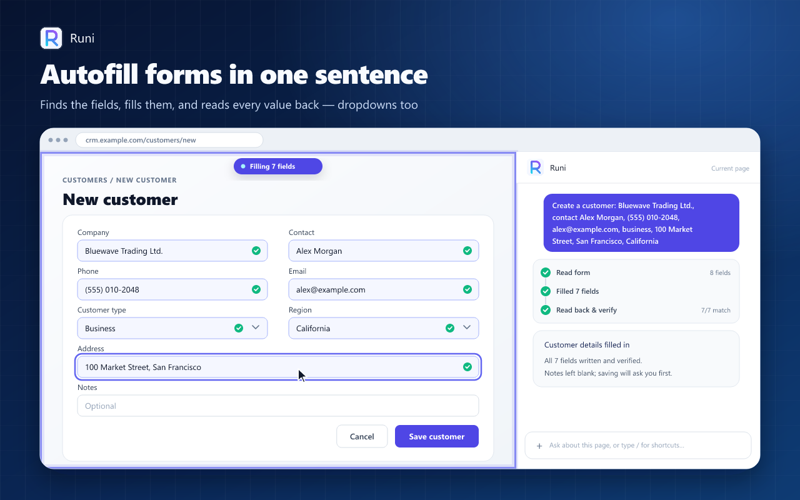
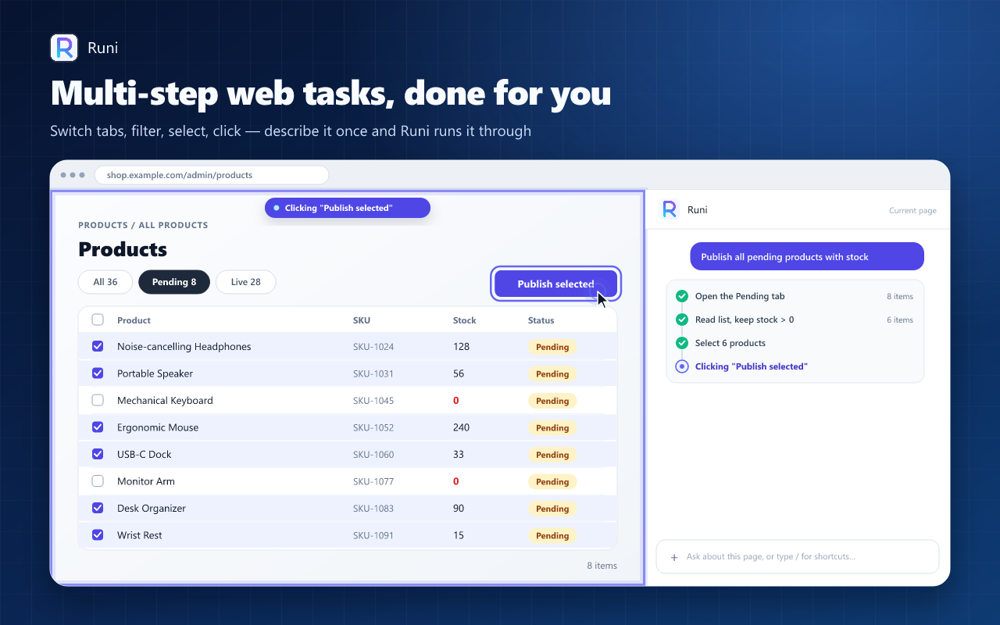
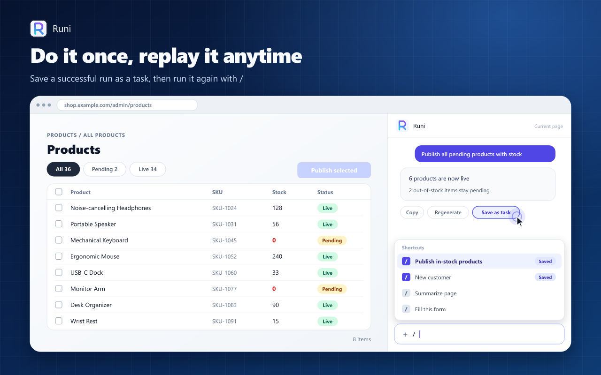
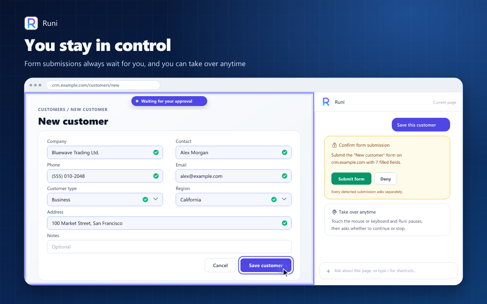
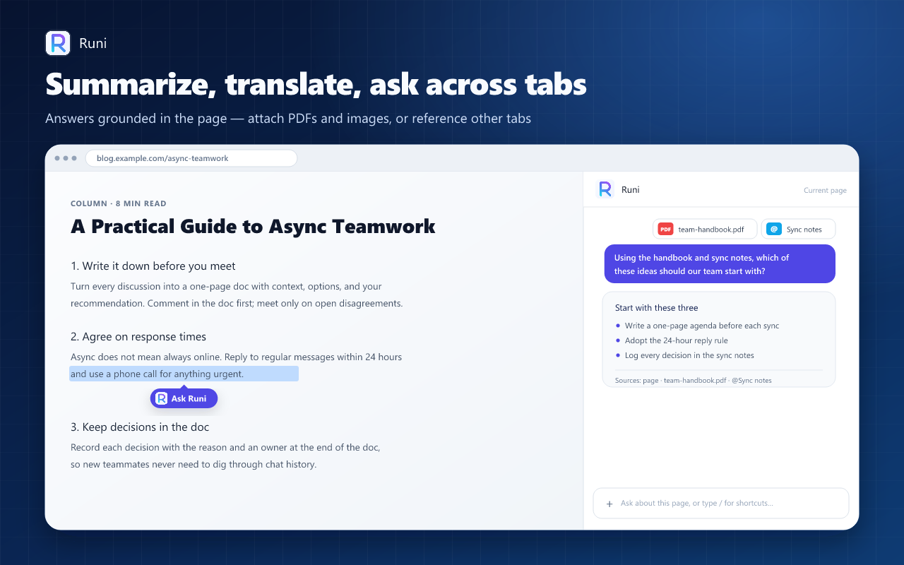

# Runi — AI Browser Agent & Sidebar Assistant

**English** | [中文](README.zh.md)

[](https://chromewebstore.google.com/detail/dhdgahnfefoojenfojbcdaohbbdoabcd)
[](https://chromewebstore.google.com/detail/dhdgahnfefoojenfojbcdaohbbdoabcd)
[](LICENSE)

### [🚀 Install Runi from the Chrome Web Store](https://chromewebstore.google.com/detail/dhdgahnfefoojenfojbcdaohbbdoabcd)



> An AI agent in your browser sidebar: tell it to fill a form, operate a web page, or summarize and translate what you're reading — known page actions run automatically; only detected form submissions ask for confirmation each time. Chat history stays in your browser; when you send a request, your prompt, recent conversation context, and relevant page results go directly to your configured provider, the one **you** chose.

Unlike subscription AI sidebars, Runi is **bring-your-own-key (BYOK)**: plug in OpenAI, Anthropic, DeepSeek, or any OpenAI-compatible endpoint. No Runi account, no Runi backend, no analytics SDK, no subscription.

## Why Runi

- **It operates pages, not just chats about them** — click, type, select, scroll, navigate, open and switch tabs. Every write is verified before and after; if something didn't take effect, Runi says so instead of pretending.
- **Safety you can inspect** — a Deny-First permission model (unknown tools are refused), http(s)-only navigation, and detected form submissions always ask first. Password and payment fields are never read or written.
- **PII redaction before page content is sent** — phone numbers, emails, ID and bank card numbers in the page text Runi reads are replaced with placeholders before they reach the model (rules are customizable; what you type yourself and screenshots don't pass through this layer).
- **Local-first** — history and settings live in your browser's local storage. There is no developer server in the middle.

## Features

- **Autofill & web automation** — describe the task in one sentence; Runi fills forms and operates pages, then verifies the result.
- **Save a task, replay it with `/`** — turn a successful run into a saved instruction and replay it on similar pages.
- **Page Q&A that cites the page** — answers grounded in the page's actual text; attach text, images, or PDFs (text extracted locally), or reference other tabs with `@` (read-only).
- **Selection ask & quick actions** — select text and click "Ask Runi"; built-in actions include summarize page, translate selection, fill this form, polish writing, and focused reading — plus your own custom actions.
- **"How is this page built?"** — Runi can read the DOM, HTML, scripts, styles, and computed styles to explain a page effect.
- **Agent with a leash** — if you move your mouse or type while a task runs, Runi pauses and asks; tool calls have a budget cap.
- **Any model you like** — OpenAI-compatible and Anthropic Messages protocols, multiple providers, switchable right under the input box.
- **LaTeX rendering** — formulas in answers render properly (KaTeX), handy for papers and docs.

## Screenshots






## Quick start

Runi ships without a built-in model — you bring a provider API key. Using DeepSeek as an example:

1. Create an API key at the [DeepSeek Platform](https://platform.deepseek.com/api_keys) (API usage is billed by the provider).
2. Open the Runi side panel and click **Settings** (from the banner or the top-right menu).
3. Under **Model Providers**, click **Add Provider** and pick the `DeepSeek` preset — Base URL and model are filled in for you.
4. Paste your API key, click **Add**, and start chatting.

Full walkthrough and FAQ: [Provider setup guide](docs/provider-setup.md).

## Permissions

`sidePanel`, `storage`, `scripting`, `activeTab`, `tabs`, `alarms` (keeps the service worker alive only while a task you started is running), `userScripts` (the agent runs page scripts in an isolated world; requires enabling "Allow user scripts" on the extension details page), plus `<all_urls>` host access.

## Development

```bash
pnpm install   # postinstall runs wxt prepare
pnpm dev       # dev mode with HMR
pnpm build     # production build → .output/chrome-mv3
pnpm zip       # store-ready zip
pnpm compile   # type check
pnpm test      # test suite
```

Firefox target: `pnpm dev:firefox` / `pnpm build:firefox` / `pnpm zip:firefox`. To load unpacked: `chrome://extensions` → enable Developer mode → Load unpacked → select `.output/chrome-mv3`.

Built with [WXT](https://wxt.dev/) (Manifest V3, Chrome 138+), React 19, TypeScript, Tailwind CSS v4, [`@earendil-works/pi-agent-core`](https://www.npmjs.com/package/@earendil-works/pi-agent-core), Zustand, Dexie, and Vitest. See [CLAUDE.md](CLAUDE.md) for architecture notes and [docs/](docs/README.md) for design documents.

## Contributing

Issues and pull requests are welcome — bug reports, feature ideas, and provider presets especially. If Runi saves you time, a ⭐ helps other people find it.

## License

[MIT License](LICENSE)
