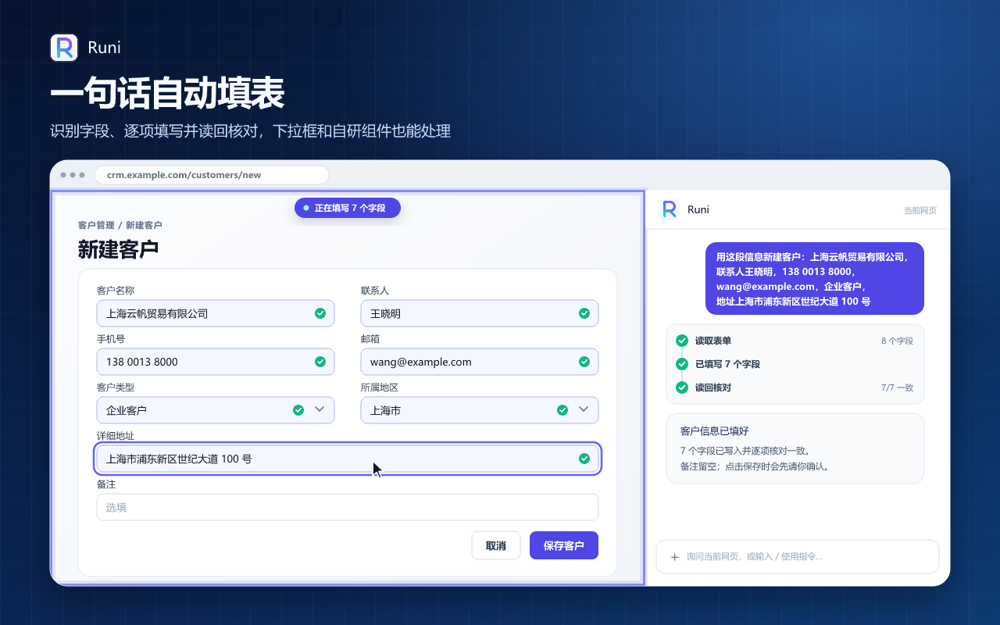
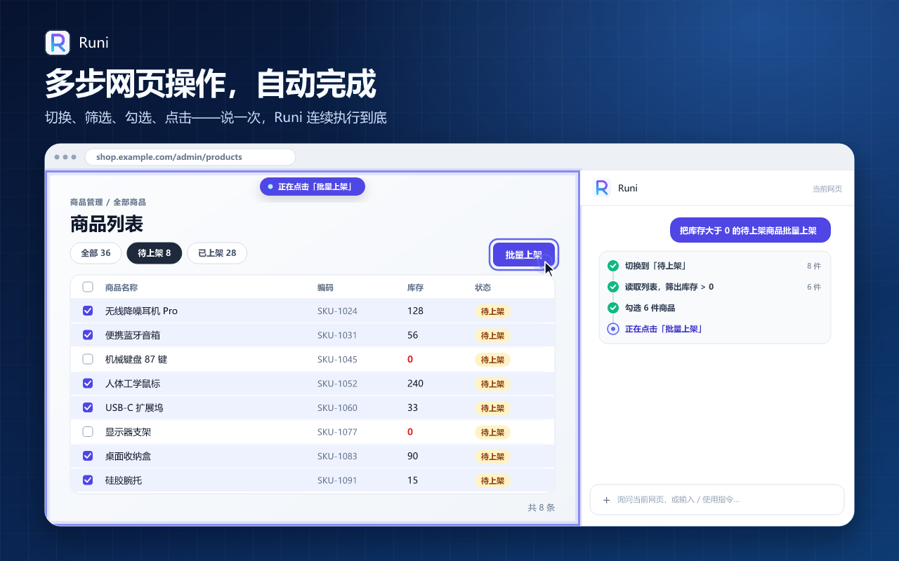
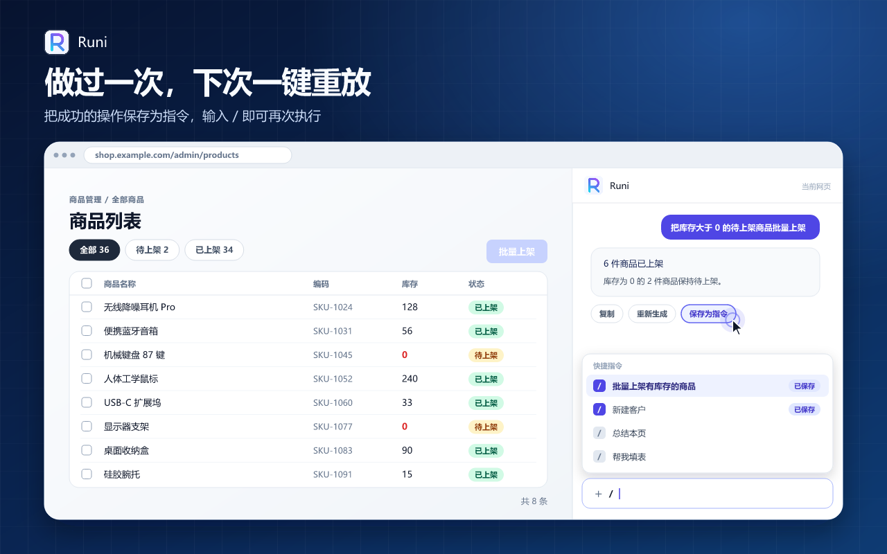
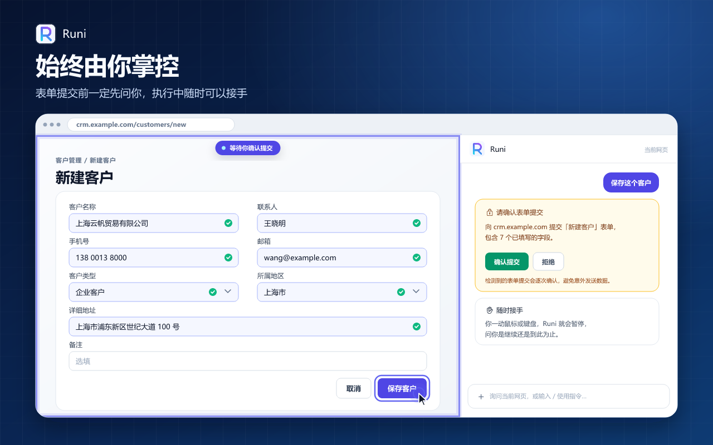
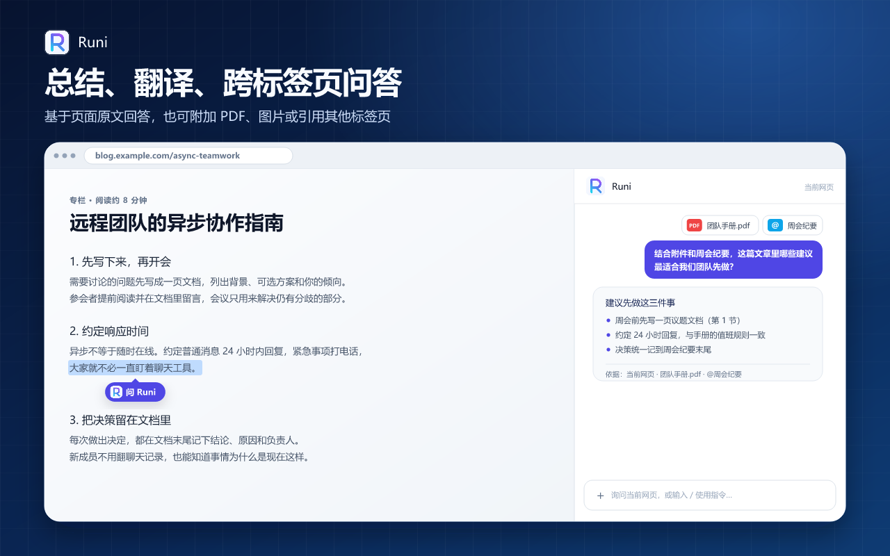

# Runi — AI 浏览器助手（侧边栏 Agent）

[English](README.md) | **中文**

[](https://chromewebstore.google.com/detail/dhdgahnfefoojenfojbcdaohbbdoabcd)
[](https://chromewebstore.google.com/detail/dhdgahnfefoojenfojbcdaohbbdoabcd)
[](LICENSE)

### [🚀 从 Chrome Web Store 安装 Runi](https://chromewebstore.google.com/detail/dhdgahnfefoojenfojbcdaohbbdoabcd)



> 浏览器侧边栏里的 AI 助手：一句话让它自动填表、操作网页，或者总结、翻译你正在看的页面。已知页面操作自动执行，只有检测到的表单提交会逐次请求确认。对话历史只保存在你的浏览器里；你发起请求后，当前提示词、近期对话上下文和相关页面结果会直接发送到你配置的 AI Provider——由**你自己**选择的那一家。

和那些订阅制的 AI 侧边栏不同，Runi 是**自带 Key（BYOK）**：接 OpenAI、Anthropic、DeepSeek，或任意 OpenAI 兼容接口。没有 Runi 账号、没有 Runi 后端、没有分析 SDK、没有订阅费。

## 为什么用 Runi

- **它真的会操作页面，不只是陪聊**——点击、输入、选择、滚动、跳转、打开和切换标签页。每次写入前后都会校验；没生效就如实说没生效，不装作做完了。
- **安全机制看得见摸得着**——Deny-First 权限模型（未知工具一律拒绝）、跳转只允许 http(s)、检测到的表单提交必先询问。密码和支付字段既不读取也不写入。
- **页面内容发送前先脱敏**——Runi 读到的页面文字里的手机号、邮箱、身份证号、银行卡号，会在发给模型之前替换为占位符（规则可自定义；你自己输入的内容和截图不经过这一层）。
- **本地优先**——历史和设置只存在浏览器本地存储里，中间没有任何开发者服务器。

## 功能

- **自动填表与网页自动化**——一句话描述任务，Runi 填表、操作页面，然后校验结果。
- **任务存下来，用 `/` 重放**——把一次成功执行存成指令，之后在相似页面一键重放。
- **基于页面原文的问答**——回答有页面实际内容作依据；可附加文本、图片、PDF（在本地提取文本），也可以用 `@` 引用其他标签页（只读）。
- **划词提问与快捷指令**——选中文字点“问 Runi”；内置总结本页、翻译划词、帮我填表、润色改写、专注阅读，也能加你自己的自定义动作。选中 Runi 回复里的一段，还能引用它继续追问。
- **“这个页面是怎么做的？”**——Runi 能读 DOM、HTML、脚本、样式和计算样式，讲解页面效果的实现方式。
- **拴着绳的 Agent**——任务执行中你一动鼠标或键盘，它就暂停询问；工具调用有预算上限。
- **模型随你选**——支持 OpenAI Chat Completions（任意兼容接口）、OpenAI Responses 和 Anthropic Messages 三种协议，内置 DeepSeek、OpenAI、Claude 一键预设；可配置多个服务商，在输入框下方直接切换。
- **LaTeX 公式渲染**——回答里的公式正常显示（KaTeX），看论文和文档很方便。

## 截图






## 快速开始

Runi 不带内置模型，需要你自备服务商的 API Key。以 DeepSeek 为例：

1. 在 [DeepSeek 开放平台](https://platform.deepseek.com/api_keys) 创建 API Key（API 用量由服务商计费）。
2. 打开 Runi 侧边栏，点顶部横幅或右上角菜单里的**设置**。
3. 在**模型 Provider**里点**添加 Provider**，选 `DeepSeek` 预设——Base URL 和模型会自动填好。
4. 粘贴 API Key，点**添加**，就能开始对话了。

完整图文步骤和常见问题见 [Provider 配置指南](docs/provider-setup.md)。

## 权限

`sidePanel`、`storage`、`scripting`、`activeTab`、`tabs`、`alarms`（仅在你发起的任务运行期间保持 Service Worker 存活）、`userScripts`（Agent 在隔离环境中运行页面脚本，需在扩展详情页开启“允许用户脚本”），以及 `<all_urls>` 主机权限。

## 开发

```bash
pnpm install   # postinstall 会执行 wxt prepare
pnpm dev       # 开发模式，热更新
pnpm build     # 生产构建，产物在 .output/chrome-mv3
pnpm zip       # 打包成可上传商店的 zip
pnpm compile   # 类型检查
pnpm test      # 运行测试
```

Firefox 目标：`pnpm dev:firefox` / `pnpm build:firefox` / `pnpm zip:firefox`。加载未打包扩展：`chrome://extensions` → 开启开发者模式 → 加载已解压的扩展程序 → 选择 `.output/chrome-mv3`。

技术栈：[WXT](https://wxt.dev/)（Manifest V3，Chrome 138+）、React 19、TypeScript、Tailwind CSS v4、[`@earendil-works/pi-agent-core`](https://www.npmjs.com/package/@earendil-works/pi-agent-core)、Zustand、Dexie、Vitest。架构说明见 [CLAUDE.md](CLAUDE.md)，设计文档见 [docs/](docs/README.md)。

## 参与贡献

欢迎提 Issue 和 PR——尤其是 bug 报告、新功能想法和 Provider 预设。如果 Runi 帮你省了时间，点个 ⭐ 能让更多人发现它。

## 许可证

[MIT License](LICENSE)
